# RM Assistant CRM — 근본증권

> 증권사 RM(자산관리 상담역)의 하루를 따라가는 Salesforce CRM.
> 잠재고객 발굴부터 미팅 준비, 상품 추천, 조건서 생성, 만기 관리, 성과 추적까지를 하나의 흐름으로 묶었습니다.

<p>
  
  
  
  
  
  
  
</p>

**BORN(3조) 5인 팀 프로젝트** · Salesforce AI CRM 과정 최종 프로젝트 · 가상 증권사 "근본증권" 시나리오

**이상윤 — Developer (Slack · Tableau 연동, 만기 알림, 영업기회 레이더 화면)**

📑 [최종 발표 자료 (시연 영상 포함)](https://docs.google.com/presentation/d/1x-TAfkbx1M5HRorCXdKZDYr7ElnFRIyUPDb4PDniIMc/view)

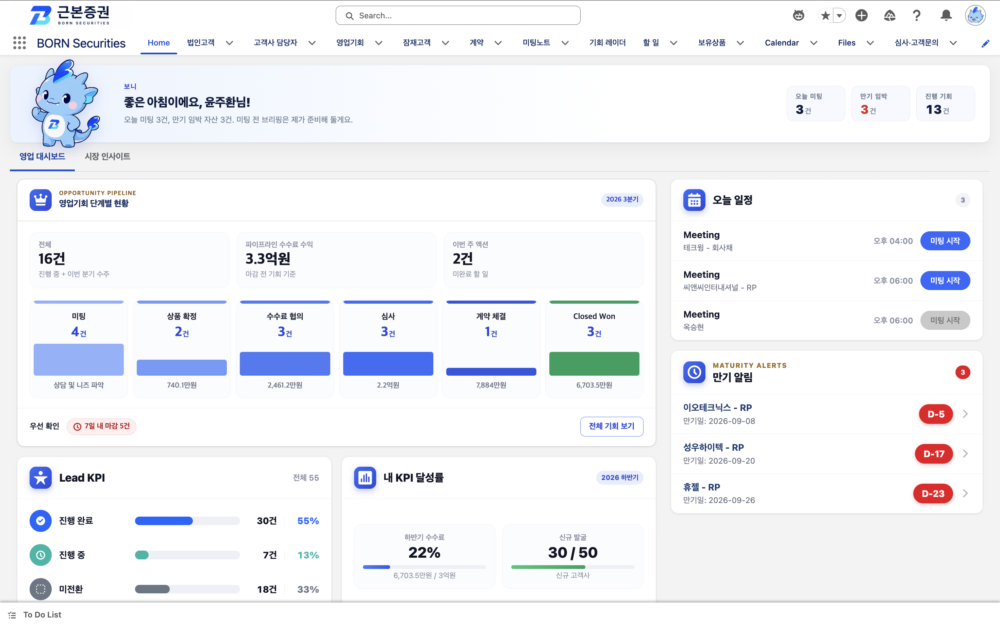

---

## 왜 만들었나

증권사 RM의 시간은 상담이 아니라 **상담 준비**에 잠식됩니다. 고객사 재무제표를 열어보고, 최근 뉴스를 훑고, 지난 미팅 기록을 뒤지고, 어떤 상품을 제안할지 정하고, 조건서를 만들고 — 여기까지가 미팅 전에 끝나 있어야 합니다. 그런데 이 정보들은 전부 다른 화면에 흩어져 있습니다.

그래서 세 가지를 목표로 잡았습니다.

1. **흩어진 판단 근거를 한 화면에** — 재무 추이, 외부 시그널, 지난 상담 이력을 미팅 준비 브리핑 한 장으로 묶습니다.
2. **반복되는 판단을 자동화** — 상품 추천, 만기 도래 고객 알림, 전환 후 후속 업무 생성을 규칙으로 옮겼습니다.
3. **놓치면 손해인 것을 먼저 보여주기** — 만기 임박, 마감 임박 기회, 목표 대비 실적을 홈에서 바로 보게 했습니다.

RM이 판단을 더 잘하도록 돕는 것이 목표이지, 판단을 대신하는 것이 목표는 아닙니다. AI가 만든 브리핑과 이메일은 전부 **초안**이며, RM이 확인하고 수정한 뒤에 나갑니다.

---

## 주요 화면

**① 성과 대시보드 — 영업기회 단계별 현황과 목표 대비 실적**
분기 목표는 Custom Metadata(`KPI_Target`)로 관리해, 목표가 바뀌어도 코드 배포가 필요 없습니다.
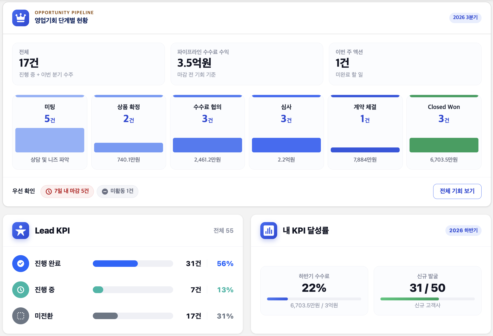

**② 미팅 준비 브리핑 (생성형 AI)**
추천상품 · 재무 하이라이트 · 최근 동향 · 미팅 포인트 · 유사 수주 확률을 상담 전에 자동으로 정리합니다.
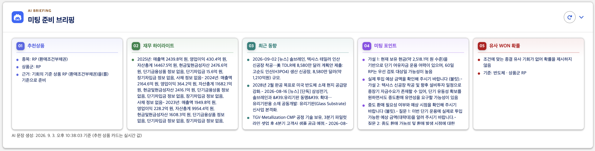

**③ 확정 조건서 PDF 자동 생성**
브리핑이 제시한 추천과 **같은 값**으로 조건서를 만듭니다 (아래 "추천을 계산하는 곳은 한 군데뿐" 참고).
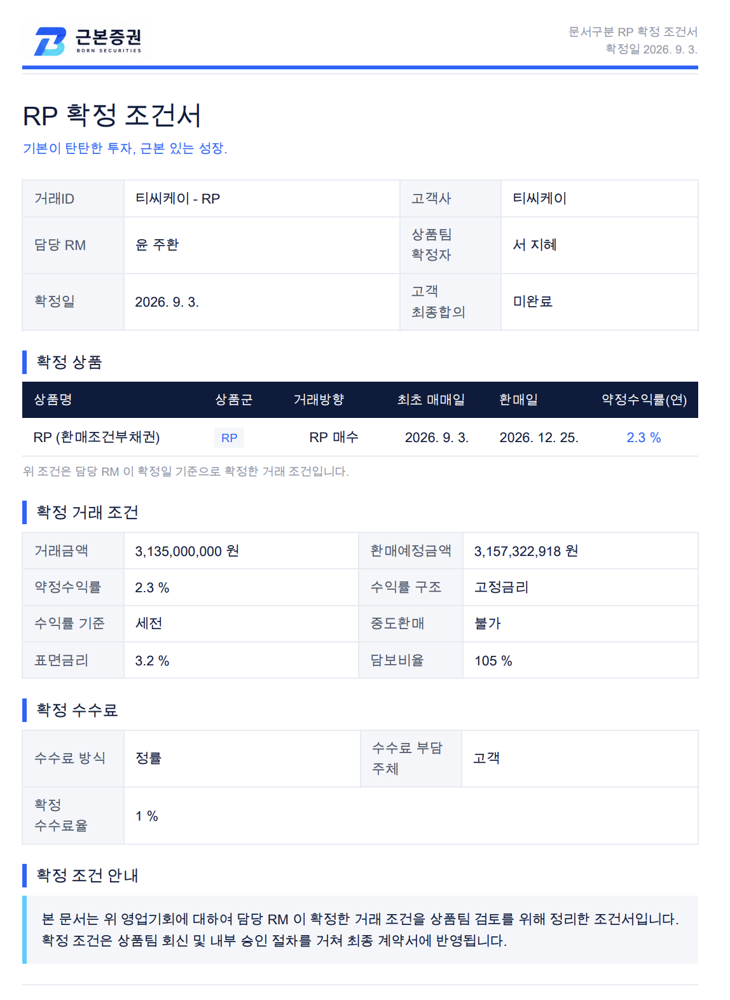

<details>
<summary>🔎 화면 더 보기 (미팅 노트 · 영업기회 레이더)</summary>

**미팅 노트 — 개인정보 마스킹 후 AI 상품 추천**
메모 원문은 그대로 보관하고, 마스킹본만 Agentforce로 넘깁니다.
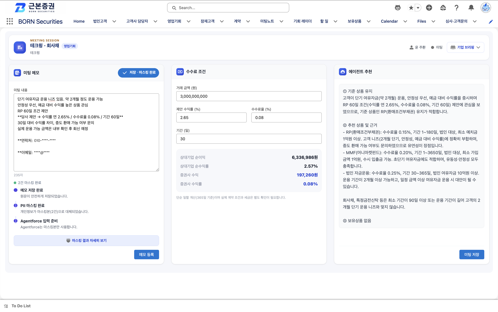

**영업기회 레이더 — 화이트스페이스 기준 유망 고객 발굴**
"고객 지갑 − 우리 잔액"을 화이트스페이스로 잡고, 성공 가능성과 교차해 공략 우선순위를 매깁니다.
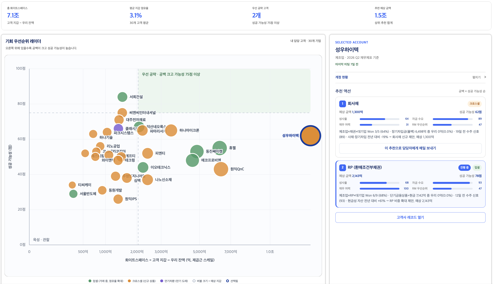

</details>

**④ 만기 알림 → 영업기회 레이더 → 맞춤 메일**
홈의 만기 알림에서 고객을 누르면 기회 레이더로 이어지고, 추천 상품을 골라 카탈로그가 첨부된 맞춤 메일까지 바로 보냅니다.
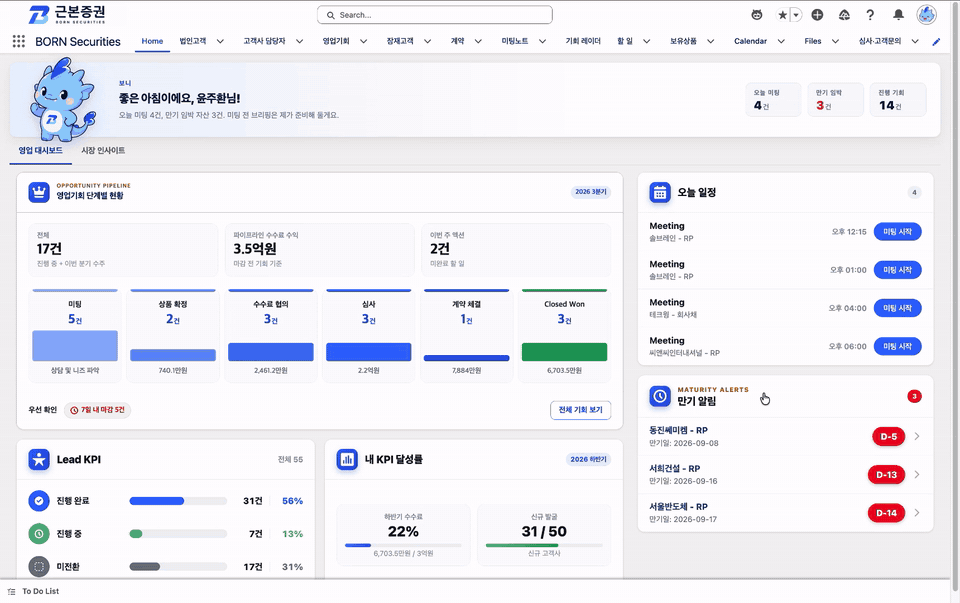

**⑤ Slack 조건 검토 · 승인 회신**
RM이 넘긴 조건이 미팅 요약 · 수수료 조건 · 승인 요청 사유와 함께 상품팀 Slack 채널로 전달되고, 상품팀은 Slack에서 바로 승인 · 반려 · 매니저 결재를 누릅니다. 결재가 끝나면 결과와 확정 조건서 PDF가 같은 채널에 자동으로 올라옵니다.
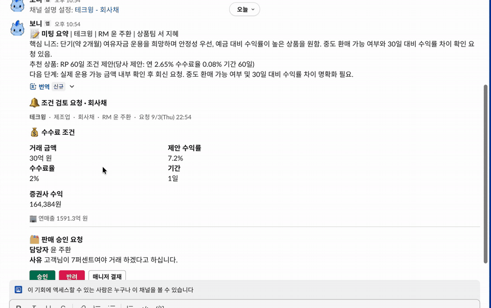

<details>
<summary>🔎 Slack 화면 크게 보기</summary>

| 조건 검토 요청 | 매니저 결재 완료 · 조건서 PDF 회신 |
|---|---|
| 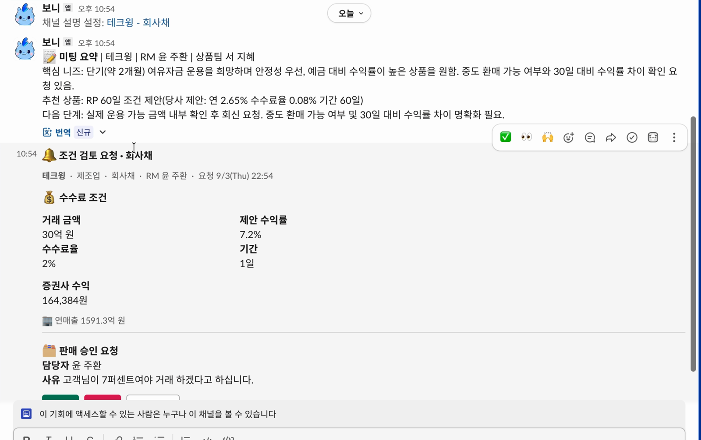 | 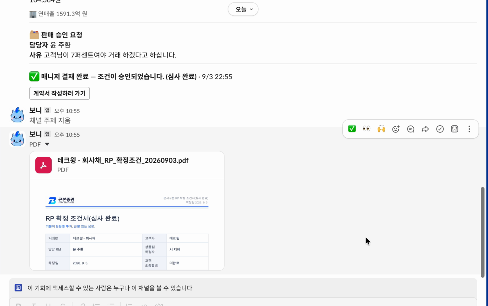 |

</details>

**⑥ Tableau 팀장 코칭 대시보드**
팀장이 고객 정보 없이 팀원별 KPI · 단계별 체류 히트맵 · 팀 영업 퍼널 · 리스크존 위험 매트릭스로 팀의 병목을 확인하고, 코칭이 필요한 팀원에게 Slack 메시지와 후속 할 일을 남깁니다.
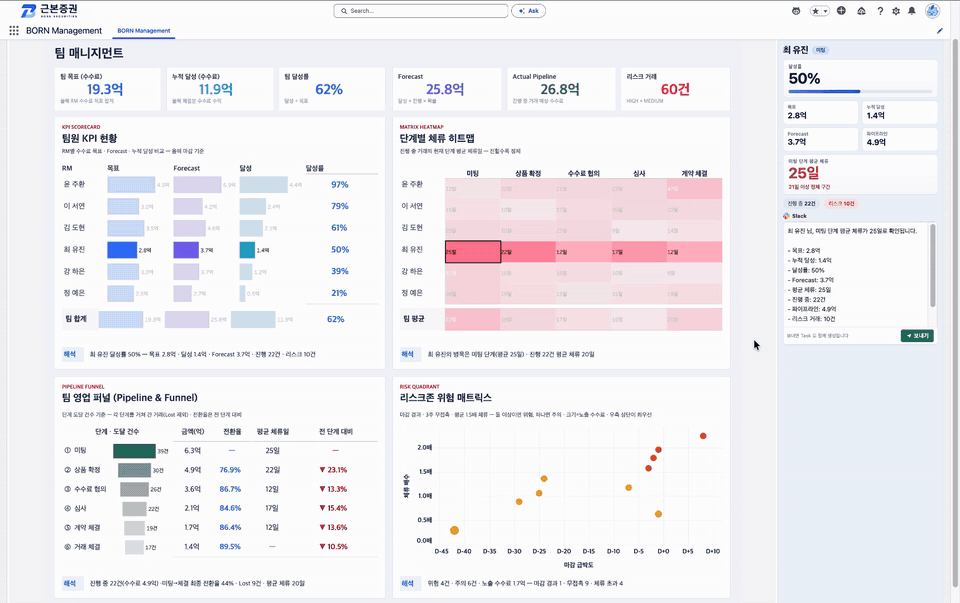

<details>
<summary>🔎 대시보드 크게 보기</summary>

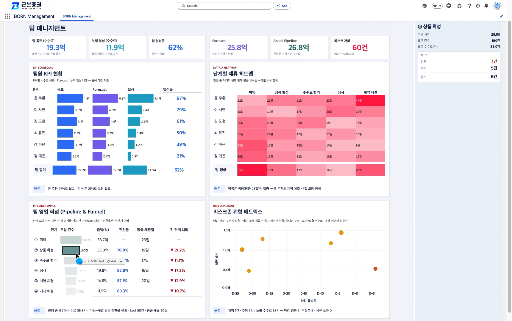

</details>

---

## 아키텍처

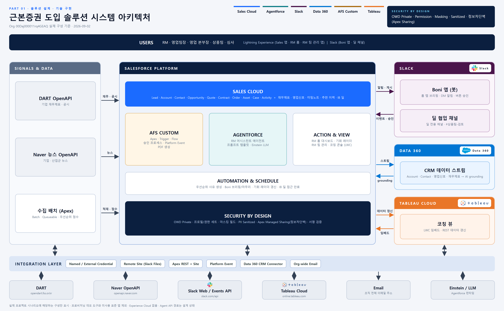

DART 공시와 뉴스 OpenAPI로 들어온 외부 신호를 Apex 배치가 적재·점수화하고, Data Cloud로 스트리밍해 AI 브리핑의 grounding 근거로 씁니다. Slack은 알림·딜 협업 채널을, Tableau는 코칭 뷰를 담당합니다.

---

## 기술적으로 신경 쓴 것

### 추천을 계산하는 곳은 한 군데뿐

미팅 준비 브리핑과 조건서 PDF는 **같은 추천 상품**을 보여줘야 합니다. 그런데 각자 계산하면 절대 일치하지 않습니다 — 계산 시점이 다르고, 참조하는 필드가 조금씩 어긋나기 때문입니다. 고객 앞에서 브리핑과 조건서의 상품이 다르면 그건 버그가 아니라 사고입니다.

그래서 계산은 `LeadRecommendationEngine` **한 곳에서만** 하고, 결과를 Lead의 다섯 필드에 저장합니다. 브리핑과 PDF는 계산하지 않고 그 값을 읽기만 합니다.

여기에 한 겹이 더 있습니다. Agentforce 에이전트도 같은 필드에 씁니다. 에이전트는 연간 재무 추이와 외부 시그널까지 더 많은 근거를 보므로, **에이전트가 기록한 값이 있으면 존중하고 덮어쓰지 않습니다.** 이 엔진은 "아직 아무 추천도 없는 리드"를 재무 기준으로 채우는 역할만 맡습니다.

### 근거 블록 격리 — 필드 하나 때문에 브리핑 전체가 죽던 문제

브리핑은 CRM 프로필 · 우선순위 · 연간 재무 · 분기 재무 · 유사 수주 · 외부 시그널의 여섯 블록을 조회해 조립합니다.

처음에는 이 조회를 하나의 `try/catch`로 감쌌습니다. 문제는 `WITH USER_MODE` 쿼리의 동작이었습니다 — **SELECT 필드 중 단 하나라도 FLS가 없으면 쿼리 전체가 `QueryException`을 던집니다.** 실제로 분기 재무 블록의 필드 하나(`Disclosure_Period_YM__c`)에 권한이 빠져 있었는데, 단일 `try/catch`가 이를 통째로 삼켜 멀쩡한 연간 재무까지 "재무 데이터 없음"으로 뭉개버렸습니다. 화면에는 아무 오류도 없이 빈 브리핑만 나왔습니다.

지금은 블록마다 독립적으로 조회하고 `QueryException`을 블록 단위로 잡습니다. 한 블록이 실패해도 나머지는 살아남고, **"권한이 없어서 못 읽음"과 "데이터가 없음"을 구분해서** 안내합니다. 조용히 비어 있는 화면보다 이유가 적힌 화면이 낫습니다.

### 재실행해도 중복이 생기지 않는 만기 배치

`MaturityAlertBatch`는 30일 내 만기가 도래하는 자산의 담당 RM에게 후속 Task를 만듭니다. 배치는 재실행되고, 스케줄은 리셋되고, 테스트 중에도 돌아갑니다. 그때마다 Task가 쌓이면 알림으로서 쓸모가 없어집니다.

그래서 이미 열려 있는 만기 알림 Task가 있는 자산은 건너뛰도록 **멱등하게** 만들었습니다. 중복 판정에 쓰는 SOQL LIKE 패턴은 Task 제목 상수와 **분리해서** 뒀습니다. 제목 문구를 다듬는 일과 중복 판정 규칙을 바꾸는 일은 서로 다른 이유로 일어나기 때문입니다.

### 개인정보는 마스킹본만 AI에 넘긴다

미팅 메모에는 고객 담당자의 연락처와 이메일이 그대로 적힙니다. 이 원문을 생성형 AI에 넘길 수는 없습니다.

저장 시 트리거가 원문을 마스킹해 `Sanitized_Content__c`와 마스킹 건수를 채우고, **Agentforce에는 마스킹본만** 전달합니다. 화면(LWC)은 마스킹을 직접 수행하지 않고 저장 후 재조회로 트리거가 채운 결과를 받아옵니다 — 마스킹 로직이 화면과 배치 양쪽에 중복으로 존재하지 않게 하기 위해서입니다.

에러 처리에도 판단이 들어갔습니다. 메모 저장·마스킹이 성공한 뒤 상품 추천 호출이 실패해도 **예외를 던지지 않습니다.** 추천은 부가 기능이고, 이미 성공한 저장·마스킹까지 되돌리면 사용자는 메모를 처음부터 다시 써야 하기 때문입니다.

### 전환 전에 미팅을 강제하는 게이트

Lead → Opportunity 전환은 파이프라인 숫자를 만드는 행위입니다. 미팅도 하지 않은 리드가 전환되면 KPI가 오염됩니다. Flow로 **미팅 완료를 전환의 선행 조건**으로 걸고, 전환 직후에는 트리거가 후속 Task와 미팅 Event를 자동 생성합니다. 표준 전환 화면에서 RM이 직접 고른 Opportunity RecordType을 거꾸로 되짚어 상품군과 기회명을 맞추는 처리도 함께 들어 있습니다.

---

## 담당 역할 (이상윤 · Developer)

- **Slack 연동** — 상품팀 전달 시 딜 전용 Slack 채널 자동 생성 및 조건확정서 공유, 예외 조건 검토 요청과 매니저 승인 결과 회신, 팀장 코칭 메시지, 리드 자동 전환 실패 알림
- **Tableau 팀장 대시보드** — 고객명 없이 팀원별 KPI · 단계별 체류 히트맵 · 팀 영업 퍼널 · 리스크존을 보는 코칭 뷰, 코칭 후보에게 Slack 메시지와 후속 Task로 연결
- **만기 알림** — 만기가 30일 안으로 다가온 고객을 담당 RM에게 할 일과 알림으로 알려주고, 알림에서 영업기회 레이더로 바로 이어지도록 구성
- **영업기회 레이더 화면** — 고객별 추가 영업 여지와 성공 가능성을 한 화면에서 비교하고, 추천 상품으로 맞춤 메일까지 보내는 화면
- **홈 인사 배너 · 로딩 화면** — 홈 상단의 오늘 일정 요약 배너, 레이더 · 미팅 브리핑 · 미팅 노트의 로딩 화면

| 이름 | 역할 | 담당 |
|---|---|---|
| 진승혜 | PM | User Story · Agentforce |
| 강윤지 | PL | 보안 관리 · Permission |
| 김환진 | Developer | 뉴스 · DART API |
| **이상윤** | **Developer** | **Tableau · Slack 연동** |
| 이주연 | Admin | Flow · 더미데이터 적재 |

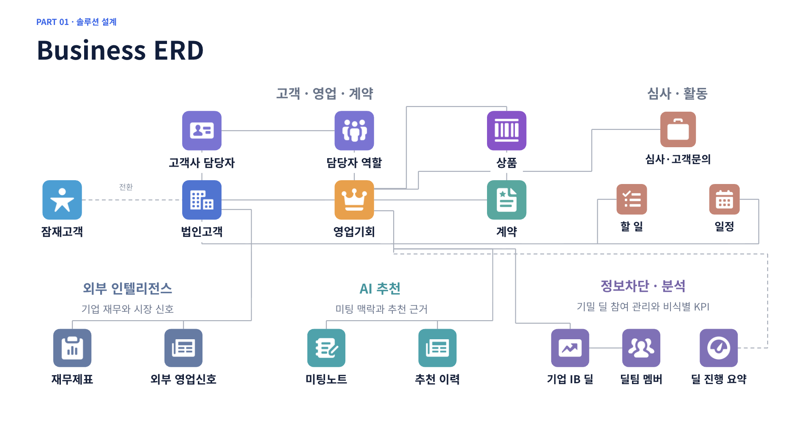

---

## 기능 요약

| 영역 | 기능 | 관련 구현 |
|---|---|---|
| **Lead 관리** | 미팅 완료를 조건으로 한 Lead 전환, 전환 시 후속 Task 자동 생성 | `LeadConvertService`, `LeadEventConvertHandler`, Flow, Trigger |
| **상품 추천** | 고객 재무 기준 금융상품 추천 (단일 계산 지점) | `LeadRecommendationEngine`, `LeadProductRecommendationService` |
| **조건서 생성** | 고객 맞춤 확정 조건서 PDF 자동 생성 | `LeadProposalController`, `LeadProposalPdfController` |
| **미팅 준비** | 상담 전 브리핑 및 이메일 초안 자동 작성 (생성형 AI) | `MeetingPrepBriefingProvider`, `Meeting_Prep_Email_Draft` |
| **만기 관리** ⭐ | 만기 30일 전 후속 Task 자동 생성 (멱등 배치), 벨 알림 → 레이더 이동 | `MaturityAlertBatch`, `MaturityAlertService` |
| **성과 관리** | RM 개인·영업기회 KPI, 목표 대비 실적 추적 | `MyKpiController`, `OpportunityKpiController`, `KPI_Target` |
| **영업기회 레이더** ⭐ | 화이트스페이스 기반 유망 고객 발굴 및 AI 아웃리치 | `walletOpportunityRadar`, `radarEmailComposer` (화면), `OpportunityRadarController`, `Opportunity_Radar_Email_Draft` |
| **Slack · Tableau** ⭐ | 딜 협업 채널 · 승인 회신 · 코칭 메시지 / 팀장 코칭 대시보드 | 발췌본 미포함 (시연 영상 참고) |

⭐ = 이상윤 담당

---

## 기술 스택

| 구분 | 사용 기술 |
|---|---|
| 플랫폼 | Salesforce (API v65.0) |
| 백엔드 | Apex — Service / Controller / Handler / Action / Batch 계층 분리, Trigger, Batchable + Schedulable |
| 프런트엔드 | Lightning Web Components (16), Flexipage, Visualforce (PDF 출력) |
| 자동화 | Flow (Record-Triggered / Screen), Apex Trigger |
| 생성형 AI | Agentforce Prompt Templates, Apex grounding Provider |
| 데이터 | Data Cloud (재무제표·외부 시그널 스트리밍), DART·뉴스 OpenAPI 연동 |
| 설정 | Custom Metadata Type (분기 KPI 목표), Permission Set, Custom Tab |
| 연계 | Slack (알림·딜 협업 채널), Tableau Cloud (코칭 뷰) |

---

## 저장소 구성

```
force-app/main/default/
  classes/               # Apex 32개 (테스트 11개 포함)
  triggers/              # Lead 전환 이벤트 처리
  lwc/                   # Lightning Web Components 16개
  flows/                 # 전환 전 미팅 검증, 전환 후 Task 생성, 이메일 초안
  genAiPromptTemplates/  # 미팅 준비 · 영업기회 레이더 이메일 초안
  objects/               # Lead / Opportunity 커스텀 필드
  permissionsets/        # RM_Assistant_Access, Opportunity_Radar
  customMetadata/        # KPI_Target (2026-H2: 수수료 3억원, 신규 50개사)
  pages/                 # 확정 조건서 PDF (Visualforce)
```

> **이 저장소는 핵심 로직 발췌본입니다.** 공개용으로 Apex·LWC·Flow·프롬프트 템플릿을 중심으로 추렸기 때문에, 코드가 참조하는 일부 오브젝트 정의(`Meeting_Note__c`, `Product_Recommendation__c`, `CorporateFinancialStatement__c`, `ExternalSignal__c` 등)와 `MaskingService` / `MeetingNoteTrigger`는 포함되어 있지 않습니다. 따라서 아래 명령이 그대로 통과하지는 않으며, **코드 리뷰용으로 읽는 것을 전제로 합니다.**

```bash
# Salesforce CLI
sf org login web -a myOrg
sf project deploy start -d force-app -o myOrg   # 의존 오브젝트 선행 배포 필요
```

---

## 알려진 제약

- 조건서 PDF의 심의필 번호는 **자리표시자**입니다. 실제 심의를 거친 문서가 아니므로 고객 발송 용도로 쓸 수 없습니다.
- 스크린샷의 고객사·담당자·금액은 전부 데모 데이터입니다.
- 상품 카탈로그의 일부 요율은 확정값이 아니라 시나리오용 임시값입니다.

---

*이 저장소는 학습/포트폴리오 목적의 팀 프로젝트입니다. 원본 커밋 기록은 팀 저장소에서 가져와 그대로 유지했습니다.*
